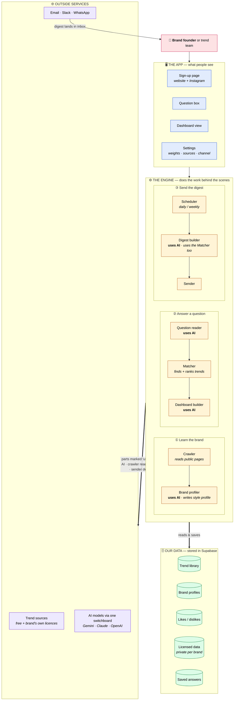
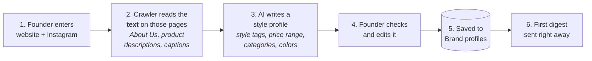
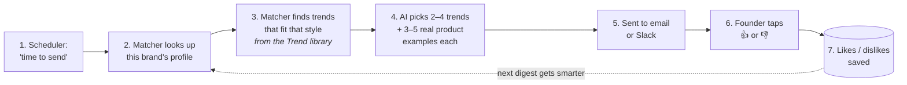
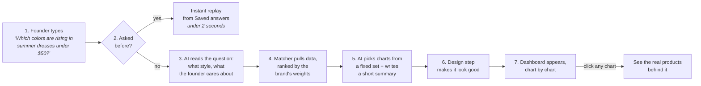

# Ask-a-Trend

**An AI trend scout for small fashion brands.** It learns a brand's style from its own website and Instagram, then sends that brand on-trend ideas that fit its look — straight to email or Slack. Brands can also type any trend question and get a dashboard built for that question.

Hackathon project by Yishan, Yizhi and Blair. The full spec is the [PRD](tasks/prd-ask-a-trend-dashboard.md); the research behind it is in [research notes](tasks/research-2026-10-24.md); **who builds what** is in the [build plan](tasks/build-plan.md).

> Status: **planning** — the PRD is final, no app code yet.
>
> 🌐 **Live site:** https://june-not-oct-hackathon.vercel.app (shows "not found" until the first app code is merged)

---

## The big picture

🗺️ **Interactive version:** [Ask-a-Trend System Map](https://june-not-oct-hackathon.vercel.app/system-map.html) — tap any part to see what it calls, what data it touches, and who builds it. The page lives in this repo at [`public/system-map.html`](public/system-map.html); open it straight from your laptop too.

Everything in one map, top to bottom: **people** use the **app**; the app hands work to the **engine**; the engine reads and saves **our data** and reaches **outside services** for AI, trend sources and message delivery. The three journeys below show each path step by step.

**Colour key:** 🩷 people · 🔵 screens in the app · 🟡 engine parts · 🟢 stored data · 🟣 outside services.

---

## The three journeys

### Journey 1 — A brand signs up (one time, ~5 minutes)

We read **words, not pictures** — it's far cheaper and the text is usually enough to tell a brand's style.

### Journey 2 — The digest arrives (every day or week) ⭐ lead feature

Colors are always named from one fixed color list, so "butter yellow" means the same thing every week. Examples are **real products** from our library — the AI never invents designs.

### Journey 3 — Ask a question, get a dashboard

---

## Who touches which data

| Data | What's in it | Written by | Read by |
|---|---|---|---|
| **Trend library** | Products, trending keywords, search curves, colors, fabrics | Crawler (on a schedule) | Matcher |
| **Brand profiles** | Each brand's style tags, price range, categories, colors | Brand profiler; founder's edits | Matcher, Digest builder |
| **Likes / dislikes** | 👍/👎 on every digest item | Founder (from email/Slack) | Matcher (to improve ranking) |
| **Licensed data** | Data from WGSN, Coloro, etc. via the brand's own licence | Source connectors | Matcher — **only for that brand** |
| **Saved answers** | Finished dashboards and demo content | Dashboard builder | Question box (instant replays) |

## Where the data comes from

| Ready for the demo | Later / brand brings a licence |
|---|---|
| The brand's own website + Instagram text | WGSN · Coloro · Pantone |
| Pinterest Trends | Première Vision Paris (fabrics) |
| Google Trends | F-Trend |
| Public product lists of online stores | Heuritech |
| Museum textile archives (Met, Cooper Hewitt) | Reddit, TikTok |
| Publicly announced colors of the year | |

The crawler plays by the rules: it follows each site's crawler instructions, goes slowly, and only reads pages anyone can see without logging in. Paywalled content comes in only through the brand's own licence.

## How the AI part works

- **One switchboard for all AI calls.** It can use Gemini, Claude or OpenAI, and automatically moves to another account if one runs out.
- **Fast, cheap models by default** — speed matters more than raw power here.
- **The AI never writes code for the page.** It fills in a fixed form ("show a ranked bar chart of these colors"), and the app draws it. That keeps every dashboard reliable and on-brand.
- **Demo answers are made in advance**, so the live demo never waits on the AI.

## Tech stack

| Piece | What we use |
|---|---|
| App framework | Next.js + TypeScript |
| Website hosting | **Vercel** — project `june-not-oct-hackathon`, deploys automatically from this repo |
| Database | **Supabase** — project `june-not-oct-hackathon` (US East) |
| AI | Gemini 3.8 Flash / Claude Haiku 5.5 (decide on day 1 by timing both) |
| Email | Resend |
| Slack | Incoming webhooks |
| WhatsApp | Meta test number (demo only) |

## Getting set up

**How shipping works:** push a branch and open a pull request → Vercel builds it and posts a **preview link** on the PR → merge to `main` → it goes live at **https://june-not-oct-hackathon.vercel.app**. Nobody needs a Vercel login: preview links open for anyone who has the link (don't post them publicly).

**What you need**
1. Accept the GitHub invite to this repo (check your GitHub email).
2. Accept the Supabase invite to the "June not Oct Hackathon" organization (sent to your HBS email). You're an Administrator: you can see the database, tables and keys.
3. Clone the repo and give your coding agent this README, `CLAUDE.md`, the [PRD](tasks/prd-ask-a-trend-dashboard.md) and the [build plan](tasks/build-plan.md).

**Running it on your laptop:** create a file named `.env.local` in the project folder (it's ignored by git — never commit it) with these three lines. Get the values from Supabase → project `june-not-oct-hackathon` → Project Settings → API Keys / Data API.

| Setting | What it is | Where to copy it from |
|---|---|---|
| `NEXT_PUBLIC_SUPABASE_URL` | The database's web address | Data API → Project URL |
| `NEXT_PUBLIC_SUPABASE_PUBLISHABLE_KEY` | Public key, safe in the browser | API Keys → Publishable key |
| `SUPABASE_SECRET_KEY` | Secret key, **server code only** | API Keys → Secret key |

The live and preview sites already have all three set in Vercel.

**Running it on Replit (second host):** in Replit choose Create → Import from GitHub, connect GitHub and pick `skayjay01/june-not-oct-hackathon`. Add the three settings above under Tools → Secrets, plus `SITE_URL` set to the Replit address (so links in emails point back to Replit). Press Run to preview, or Deploy → Autoscale to publish. The daily digest email only runs from Vercel, so it isn't sent twice.

## Team

| | GitHub | Builds |
|---|---|---|
| Yishan | skayjay01 | Engine & AI (40%) |
| Yizhi | coachbhuang | App, data & delivery (40%) |
| Blair | zhangjiayuanmun9-code | Fashion sense & evaluation (20%) |
