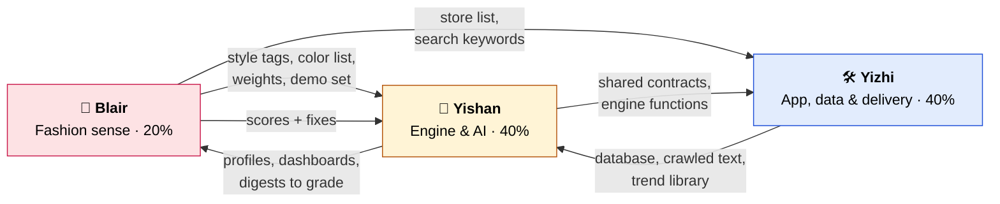

# Build Plan — three parallel workstreams

How the team splits the Ask-a-Trend build so three people, each with their own coding agent, can build at the same time without stepping on each other. Read with the [PRD](prd-ask-a-trend-dashboard.md) and the [README](../README.md) diagrams.

| Workstream | Owner | Share | In one line |
|---|---|---|---|
| **A — Engine & AI** | Yishan | 40% | Everything that "thinks": AI switchboard, brand profiler, question reader, matcher, dashboard and digest builders |
| **B — App, data plumbing & delivery** | Yizhi | 40% | Everything people see and everything that moves data: app scaffold, database, crawler + connectors, screens, email/Slack/WhatsApp |
| **C — Fashion sense & evaluation** | Blair | 20% | Everything that needs fashion judgement: style vocabulary, color list, which sources and brands to use, demo set, weights, and grading the output |

Shares are effort points: every task below has points, and each workstream adds up to its share of 100.

**Tech stack [ASSUMPTION — change here if the team decides otherwise]:** Next.js (App Router) + TypeScript on Vercel, Supabase (Postgres) for data.

---

## How to use this with your agent

1. Give your agent this file, the PRD, the README and `CLAUDE.md`, and tell it: *"You own Workstream X. Build only tasks in Workstream X, only inside the folders Workstream X owns."*
2. Build against the **shared contracts** below. If a dependency isn't ready yet, use the sample data (fixtures) the contract owner provides — don't wait.
3. One branch per task, named `<name>/<task-id>` (e.g. `yizhi/B4`). Small pull requests to `main`; merge when checks pass.
4. Need to change something another workstream owns (a contract, a table)? Open a PR and tell its owner in the group chat — don't edit it silently.
5. Any change to Vercel settings, scheduled jobs (`vercel.json`) or environment/secret files needs Yishan's OK before merging.

## Folder ownership

| Folder | Owner | What lives there |
|---|---|---|
| `lib/contracts/` | Yishan | Shared shapes (TypeScript types + JSON schemas) every workstream codes to |
| `lib/ai/`, `lib/engine/` | Yishan | AI switchboard, profiler, question reader, matcher, builders |
| `app/`, `components/` | Yizhi | Pages and UI components |
| `lib/sources/` | Yizhi | Crawler and source connectors |
| `lib/delivery/` | Yizhi | Email, Slack, WhatsApp senders; scheduler |
| `supabase/` | Yizhi | Database migrations |
| `data/curation/` | Blair | Fashion vocabulary, color list, store lists, presets, demo set (JSON/CSV the code reads) |
| `evals/` | Blair | Grading rubric and scored results |

---

## Shared contracts (agree these first)

These are the hand-off points between workstreams. Owner writes them in `lib/contracts/` in Phase 0, with a sample (fixture) of each so others can build before the real thing works.

**Data shapes (owner: Yishan; tables: Yizhi)**
- **TrendItem** — one record in the Trend library: source, collected date, type (product / keyword / color / fabric / pattern), category, attributes (colors, silhouette, material, pattern, style tags), price, image URL, link, metrics (e.g. search interest, growth).
- **BrandProfile** — brand name, URLs, style tags (from Blair's list), price range, core categories, typical colors (from Blair's color list), summary paragraph, edited-by-user flag.
- **Weights** — per-dimension weights totaling 100 (price fit, social buzz, growth speed, competitor adoption, style fit), plus preset name.
- **DashboardSpec** — title, summary, list of widgets; each widget = chart type (trend line, ranked bar, image grid, big number, comparison, color swatches), query name + parameters, caption, source, date range, data rows.
- **DigestSpec** — brand, date, 2–4 trend elements; each = name, color name (from list), one-sentence reason, "fits your brand because…", 3–5 example TrendItems.
- **Feedback** — brand, digest item, 👍/👎, time.

**Engine functions (owner: Yishan) — called by Yizhi's app**
- `buildProfile(brandId)` → BrandProfile (reads crawled text Yizhi's crawler saved).
- `answerQuestion(brandId, question)` → streams a DashboardSpec.
- `buildDigest(brandId)` → DigestSpec.

**Delivery and data functions (owner: Yizhi) — called by Yishan's engine and the scheduler**
- `crawlBrand(brandId)` → saves the brand's page text.
- `runConnectors()` → refreshes the Trend library.
- `sendDigest(brandId, digest, channel)` → delivers by email / Slack / WhatsApp.

**Curation files (owner: Blair) — read by Yishan's engine and Yizhi's crawler**
- `data/curation/style-tags.json`, `categories.json`, `attributes.json`
- `data/curation/colors.json` (name + hex + family)
- `data/curation/stores.csv` (store, URL, style segment, price tier, public product list yes/no)
- `data/curation/keywords.csv` (seed search terms for Pinterest / Google Trends)
- `data/curation/presets.json` (weight presets)
- `data/curation/demo-set.md` (demo brands + questions + what a good answer looks like)

---

## Workstream A — Engine & AI · Yishan · 40 points

| ID | Task | Pts | Done when | Needs |
|---|---|---|---|---|
| A0 | **Contracts** — write all shared shapes + fixtures in `lib/contracts/` | 3 | Others can import types and sample data | — |
| A1 | **AI switchboard** — one function all AI calls go through; Gemini/Claude/OpenAI; multiple accounts with automatic failover when one runs out; fast model by default; JSON-schema output; per-step timing log; cache for repeat questions | 7 | A test call succeeds, and still succeeds with the first account disabled; timings logged | Yishan's AI accounts |
| A2 | **Brand profiler** — crawled text → BrandProfile using Blair's style tags and color list | 5 | 3 demo brands produce profiles Blair rates "accurate" (C6) | B2, C1, C2 |
| A3 | **Question reader** — question → structured intent (style, category, price range, which dimensions matter, time window); out-of-scope detection with a suggested alternative | 5 | 5 demo questions + 5 off-topic questions handled correctly | A1 |
| A4 | **Matcher** — predefined, parameterized queries over the Trend library, ranked by Weights, brand profile, licensed data (that brand only) and feedback | 8 | Same question gives visibly different ranking under different presets | B1 tables, C5 |
| A5 | **Dashboard builder** — picks widgets from the fixed set, fills data, writes summary, design step; streams widget by widget; schema-validated with one retry | 7 | All 5 demo questions produce valid specs; streaming works | A3, A4 |
| A6 | **Digest builder** — picks 2–4 trend elements + 3–5 real examples each, color names only from the list, "fits your brand because…" | 5 | Demo-brand digests pass Blair's rubric (C6) | A4, C2 |

## Workstream B — App, data plumbing & delivery · Yizhi · 40 points

| ID | Task | Pts | Done when | Needs |
|---|---|---|---|---|
| B0 | **Scaffold** — Next.js app, connect Supabase + Vercel env vars, deploys from `main` | 3 | Hello page live on Vercel, reading from Supabase | Supabase/Vercel access |
| B1 | **Database** — migrations for brands, crawled text, Trend library, profiles, weights, feedback, licensed data (private per brand), saved answers, latency log | 4 | Tables exist; licensed data readable only for its own brand | A0 |
| B2 | **Crawler framework** — follows robots.txt, rate-limited, public pages only, per-source record of terms; switch-off per source | 4 | Crawl of one demo brand saves its About/product/alt text | — |
| B3 | **Connectors** — brand site + Instagram text; store product lists (from Blair's `stores.csv`); Google Trends (with cached fallback file); Pinterest Trends (apply for API on day 1); Met + Cooper Hewitt | 8 | Trend library holds data for every category in the demo set | B1, B2, C3 |
| B4 | **Onboarding + profile screens** — form, crawl progress, profile review/edit | 5 | New brand → editable profile in under 5 minutes | A2 (fixture first) |
| B5 | **Question box + dashboard view** — example questions, streaming render of the 6 chart types, evidence panel (click a chart → real items), follow-up box | 9 | Fixture DashboardSpec renders fully; then live specs from A5 | A0 fixtures, A5 |
| B6 | **Settings** — weight sliders + presets, licensed-source "connect" (bring your own licence), digest channel + frequency | 3 | Changing preset re-ranks without a new AI call | C5 |
| B7 | **Delivery** — Resend email, Slack webhook, WhatsApp test number, daily/weekly scheduler, "send test now", 👍/👎 links that save Feedback | 4 | Demo digest arrives by email and Slack; 👍 saves a row | A6 (fixture first) |

## Workstream C — Fashion sense & evaluation · Blair · 20 points

Blair's agent can draft each list; Blair's job is the fashion judgement — choosing, cutting, naming and grading.

| ID | Task | Pts | Done when | Needs |
|---|---|---|---|---|
| C1 | **Fashion vocabulary** — style tags (~30–50, e.g. "Y2K", "quiet luxury", "gorpcore"), categories, attributes (silhouettes, materials, patterns) | 3 | JSON files merged; engine uses them | — |
| C2 | **Color list** — ~60–100 named colors with hex and family, seeded from publicly announced WGSN×Coloro and Pantone colors | 3 | `colors.json` merged | — |
| C3 | **Source curation** — 20–40 small/mid online stores across style segments and price tiers (check each has a public product list); seed keywords for Pinterest/Google Trends; confirm which "F-Trend" is meant; one-line notes on paid sources | 4 | `stores.csv` + `keywords.csv` merged; crawler can run on them | — |
| C4 | **Demo set** — pick 3 demo brands (different styles), write 5 demo questions, and describe what a good answer looks like for each | 3 | `demo-set.md` merged; Yishan + Yizhi build to it | — |
| C5 | **Default weights + presets** — values for "Price-sensitive / mass market", "Niche streetwear", "Fashion house / editorial", with a one-line reason each | 2 | `presets.json` merged | — |
| C6 | **Evaluation** — rubric for profiles, digests and dashboards ("accurate?", "on-trend?", "fits the brand?", "would a founder use it?"); score every demo output; file fixes as issues for A/B | 5 | Scores in `evals/`; every demo output rated ≥ "good" before the presentation | A2, A5, A6 |

**Start C1–C4 on day 1** — the engine and crawler both need them early.

---

## Timeline

| Phase | When | What |
|---|---|---|
| **0 — Foundations** | First ~3 hours | A0 contracts + fixtures · B0 scaffold + B1 database · C1, C2 first drafts · apply for Pinterest and Meta APIs |
| **1 — Parallel build** | Day 1–2 | A1–A4 · B2–B5 (against fixtures) · C3–C5 |
| **2 — Plug together** | Day 3 | Swap fixtures for real engine calls · A5, A6 · B6, B7 |
| **3 — Polish + demo prep** | Final day | C6 grading + fixes · pre-generate demo content · rehearse · pitch |

### Who hands what to whom

For task-by-task dependencies, see the **Needs** column in each workstream table.
